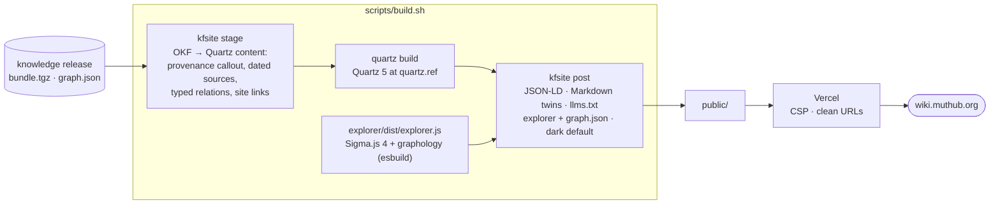

# Knowledge Foundation website

**The public face of the Knowledge Foundation: a knowledge graph you can walk, with every note's provenance in view.**

[](https://github.com/muthub-ai/knowledge-foundation-site/actions/workflows/ci.yml)
[](LICENSE)
[](https://quartz.jzhao.xyz)
[](https://www.sigmajs.org)

**Live:** [wiki.muthub.org](https://wiki.muthub.org) · **Content and rules:** [knowledge-foundation](https://github.com/muthub-ai/knowledge-foundation) · **Replicate it:** [docs/plan](docs/plan/README.md) · **Decisions:** [docs/decisions](docs/decisions/README.md)

The home page is a [Sigma.js 4](https://www.sigmajs.org) (WebGL) explorer over the knowledge graph; the notes are
rendered by [Quartz 5](https://quartz.jzhao.xyz). The site reads exactly one thing, a release of the knowledge
repository (`bundle.tgz` and `graph.json`), and never imports its code.

## What a reader gets

| Surface | What it shows |
|---|---|
| **Home: the graph** | Themes as hubs on a ring, notes orbiting them, shape by kind. Hover lights a neighbourhood; click opens an inspector with the note's **review state, connections, source date and re-check date**; a list view is the same data as a provenance table. Search finds notes and entities by any of their names. Dark by default, light on request, `prefers-reduced-motion` respected |
| **The semantic layer** | Semantica's entities and machine-suggested relations, counted apart from the curated graph ("+ N entities … found by Semantica · machine-extracted, not reviewed · Show them"), grey, hidden until asked for, with the quoted evidence for every suggestion |
| **Note pages** | A provenance callout (reviewed or not, last verified, drafted by, re-check date, number of sources), the note, its dated sources, typed relations and See also, backlinks, popovers |
| **For machines** | A Markdown twin of every note (the OKF file itself), `llms.txt`, sitemap, RSS, JSON-LD on every note, `graph.json` with CORS |

## Architecture



| Concern | How it is handled |
|---|---|
| Coupling | Release assets only; a schema (`graph.schema.json` in the knowledge repo) is the contract |
| Security | Strict Content-Security-Policy on the explorer: no inline scripts or styles; colours set through data attributes |
| Reproducibility | Quartz pinned by commit (`quartz.ref`); npm locked; the explorer bundle committed and checked for drift in CI |
| Honesty in the UI | Machine-found structure is labelled, grey, hidden by default and never counted with authored connections |
| Accessibility | Keyboard search ("/"), Escape to leave focus, live-region announcements, reduced motion, 44 px touch targets |

## Quickstart

Needs Python 3.12 and Node 22.

```bash
pip install -r requirements.txt
KF_BUNDLE=../knowledge-foundation/wiki KF_GRAPH=../knowledge-foundation/dist/graph.json bash scripts/build.sh
python3 tests/serve.py public 8765          # http://127.0.0.1:8765, clean URLs and vercel.json headers, as on Vercel
```

Without `KF_BUNDLE` the build downloads the latest knowledge release (or the tag in `KF_RELEASE`), which is what Vercel does.

## Tests

```bash
pip install -r requirements-dev.txt
python -m unittest discover -s tests -v     # stage, post, release download
npm install && npx playwright install chromium
KF_QUARTZ=1 npx playwright test             # Quartz pages and the explorer, desktop and Pixel 7
```

`tests/serve.py` sends the response headers from `vercel.json`, so a CSP violation fails the browser tests as a
console error. Without npm, `python tests/build_preview.py --bundle … --graph …` builds with a Quartz stand-in and the
explorer tests still run. CI runs the real Quartz build, unit and browser tests, the confidential-terms scan of the
built site, and the explorer-bundle drift check on every pull request.

## Repository map

| Path | What it is |
|---|---|
| `kfsite/` | `stage` (bundle → Quartz content) and `post` (finish `public/`) |
| `explorer/` | The home page: `index.html`, `explorer.css`, `theme.js`, `src/explorer.ts`, committed `dist/explorer.js` |
| `quartz.ref`, `quartz.config.yaml`, `quartz/` | Pinned Quartz commit, generated config, custom styles |
| `scripts/` | `build.sh`, `vercel_build.sh`, `build_explorer.mjs`, `fetch_release.py`, `make_quartz_config.py` |
| `tests/` | Unit tests, Playwright specs, a Vercel-like server, a Quartz stand-in |
| `vercel.json` | Build command, ignored-build rule, security headers and CSP |
| `docs/` | [Explorer design notes](docs/explorer-design.md), [decisions](docs/decisions/README.md), [replication plan](docs/plan/README.md) |

## Deploy

`main` is production: a merge deploys wiki.muthub.org, and each knowledge release triggers a rebuild through a deploy
hook. Branches get private previews; a failed preview shows its build log as the page, so the GitHub check
**build and test** is the merge gate. Details, rollback and failure modes: [docs/plan/05-operations.md](docs/plan/05-operations.md).

## Licence

Code: MIT ([LICENSE](LICENSE)). The notes rendered here are CC BY 4.0, from the knowledge repository.
Views are the author's own and do not represent his employer.
